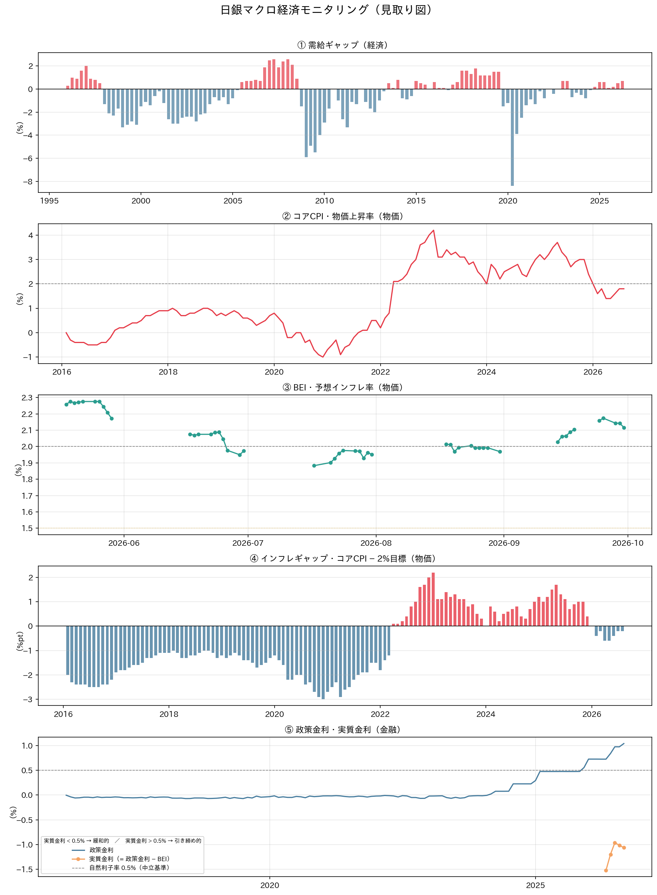
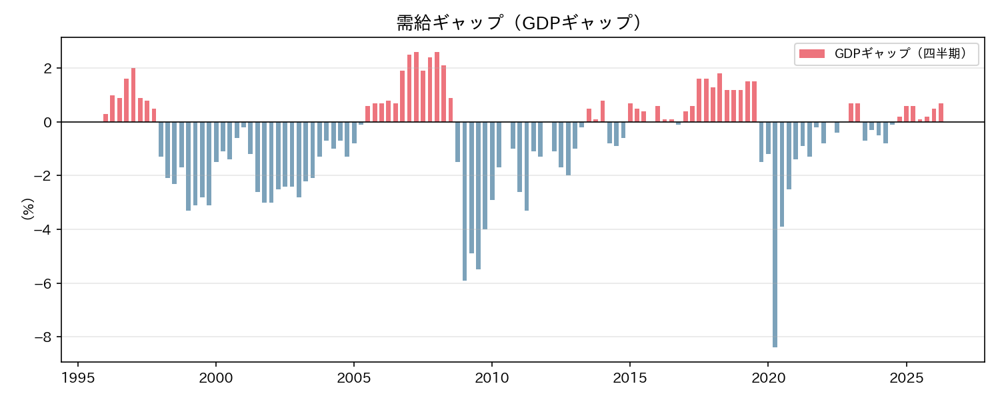
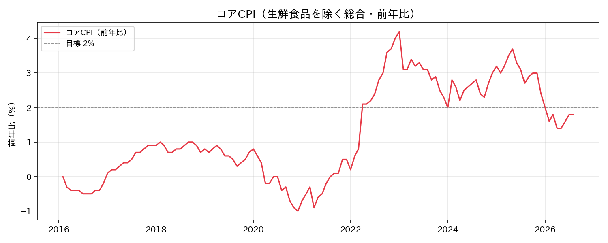
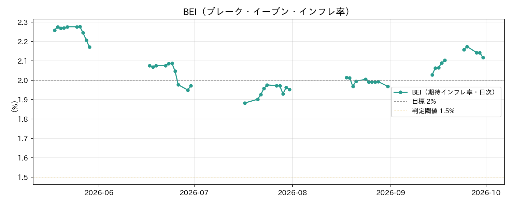
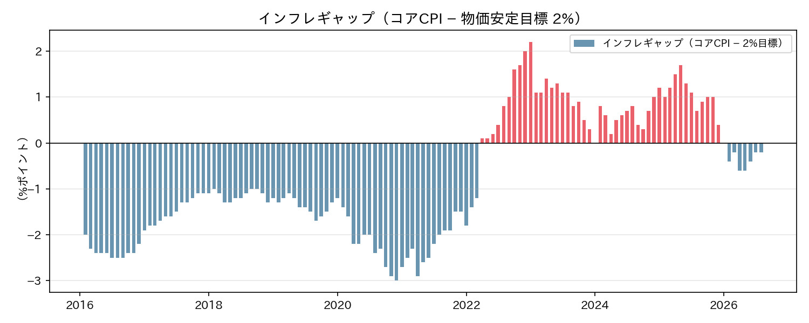
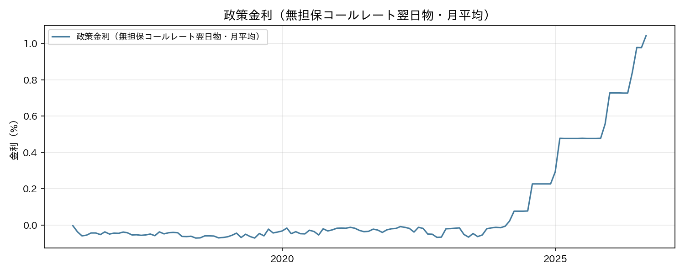

# マクロ経済考察レポート（2026-10-12）

> 生成日時: 2026-10-12

---

## エグゼクティブサマリー

**前回レポート（2026-09-13）で挙げた3つのウォッチポイントのうち、日銀の判断と為替の方向がはっきりした回である**。①8月分のコアCPIは**1.8%**で、7月と同じ水準を維持した。②前回「休止か打ち止めか」と問うた日銀は、**9月に利上げを再開した**（政策金利は月末値で0.977%→**1.226%**）。③9月に153円台まで進んだ円高は、**9月14日の153.42円を底に反転し、158円台まで円安に戻した**。

BEI（期待インフレ率）は、取得できた9月後半（9/14〜9/30）の平均が**2.108%**と、8月後半の1.993%から上昇し、最新値（9/30）も**2.117%**と2%を明確に上回った。取得できている範囲では、5月後半（2.253%）以来の高さである。一方でコアCPIは1.8%のまま動かなかったため、**前回0.17%ポイントまで縮まったCPIとBEIの乖離は、0.32%ポイントへ再び広がった**。今回は「期待が実績を引き離した」形である。

テイラールールの適正金利は**2.55%**で前回と同じ（コアCPI・需給ギャップとも前回から変化なし）。政策金利が上がった分、乖離は縮小したが、月末値（1.226%）基準でも**1.32%ポイント**の開きが残る。

市場では、前回「円高と株安が同時に進んだ」局面が反転した。日経225は9/14の63,493円から**+8.7%**上昇し、10/6には3ヶ月高値の70,684円を付けた。米10年債利回りは**5.24%**（10/5に5.31%）まで上昇し、日米金利差は4.20%ポイント（月平均基準）に拡大した。**前回「金利差で説明できない」と書いた円買いは、金利差と整合する円安方向へ戻っている**。

---

## 総合モニタリングチャート（見取り図）

5指標を「日銀の見取り図」（経済→物価→金融）の時計回り順に並べた俯瞰図。



---

## 1. 国内経済・物価指標の現状

### 1-1. 指標サマリー

| 指標 | 最新値 | 前回値 | 変化 | 評価 |
|------|--------|--------|------|------|
| コアCPI（前年比）[2026-08] | 1.8% | 1.8%（2026-07） | → 横ばい | 🟡 上昇が一服・目標まで0.2%pt |
| 政策金利（月平均）[2026-09] | 1.043%（月末値 1.226%） | 0.977%（2026-08） | ▲ 0.066%pt（月末値は ▲ 0.249%pt） | 🟢 利上げ再開 |
| 需給ギャップ [2026-Q2] | +0.7% | +0.7%（2026-Q2） | → 新規公表なし | 🟢 需要超過（Q3分は未公表） |
| BEI（期待インフレ率）[2026-09-30] | 2.117% | 1.969%（2026-08-31） | ▲ 0.148%pt | 🟢 2%超え・9月後半平均2.108% |
| 実質金利（政策金利月平均 − BEI） | −1.07% | −0.99% | ▼ 0.08%pt | 🔴 緩和的（BEI上昇で再拡大。月末値基準では −0.89%） |

🟢 良好・目標方向　／　🟡 やや外れ　／　🔴 要注意・目標から乖離

> **補足**: 需給ギャップは、前回レポートの時点で既に2026年Q2分（+0.7%）が公表済みである。Q3分はまだ公表されておらず、今回の数字に変化はない。

---

### 1-2. テイラールール：適正政策金利の試算

```
【テイラールール】
適正金利 ＝ 均衡実質金利 ＋ 目標インフレ率 ＋ 0.5 × 需給ギャップ ＋ 1.5 × インフレギャップ

均衡実質金利（自然利子率）: 0.5%（日銀リサーチ推計レンジ中央値）
目標インフレ率: 2.0%
需給ギャップ: +0.7%
インフレギャップ（コアCPI − 2%）: 1.8% − 2.0% ＝ −0.2%

適正金利 ＝ 0.5 ＋ 2.0 ＋ 0.5 × 0.7 ＋ 1.5 × (−0.2)
         ＝ 0.5 ＋ 2.0 ＋ 0.35 − 0.3
         ＝ 2.55%
```

| 項目 | 月平均基準（前回との継続性） | 月末値基準（現在の実勢） |
|------|------|------|
| テイラールール適正金利 | **2.55%**（前回 2.55%） | **2.55%** |
| 現在の政策金利 | 1.043%（前回 0.977%） | 1.226% |
| 乖離（過剰緩和幅） | **−1.51%pt**（前回 −1.57%pt） | **−1.32%pt** |

入力値（コアCPI 1.8%・需給ギャップ +0.7%）が前回と同じため、**適正金利は2.55%のまま動かない**。乖離が縮んだのは、日銀が9月に政策金利を引き上げたことだけが理由である。

月平均（1.043%）は、利上げが月の途中で行われたため、新しい水準（1.226%）を一部しか反映していない。**実勢を見るなら月末値の1.226%が適切**で、その場合の乖離は−1.32%ポイントになる。3ヶ月連続で拡大していた乖離（1.01 → 1.17 → 1.57%pt）は、今回初めて縮小に転じた。ただし、政策金利は適正水準の**約5割**（1.226 ÷ 2.55）にとどまり、正常化は道半ばである。

> **データの読み方**: 日銀の時系列統計は「月平均」と「月末値」の2列を提供している。9月の月末値が1.226%、月平均が1.043%であることから、利上げは9月下旬に行われたと読める。具体的な決定日はこのデータからは特定できない。

---

### 1-3. 指標別詳細考察

#### ① 需給ギャップ（経済ブロック）



最新は2026年Q2の**+0.7%**で、前回から変化はない。2025年Q3 +0.1% → Q4 +0.2% → 2026年Q1 +0.5% → Q2 +0.7% と4四半期連続で改善した状態が続いている。

前回レポートで「Q2は4〜6月であり、9月の急激な円高・株安はまだ反映されていない」と書いたが、**Q3分（7〜9月）が公表されるまで、その影響は需給ギャップには現れない**。今回は新しい情報がなく、前回の評価（需要超過の拡大・物価押し上げ方向）がそのまま続く。

---

#### ② コアCPI・物価上昇率（物価ブロック）



2026年8月分は**1.8%**で、7月（1.8%）と同じだった。4・5月に1.4%まで沈んだあと、6月1.6%→7月1.8%と上昇した流れは、8月には**横ばいで一服**した。目標2%まで残り0.2%ポイントという位置は変わっていない。

前回、**円高の影響は3〜6ヶ月遅れて物価に出る**と整理した。9月に進んだ円高（153円台）は、この8月分にはまだ入っていない。さらに円は9月14日を底に158円台まで戻しており、**円高による押し下げ圧力は、当初想定したよりも弱まる可能性がある**。ただし、9月分以降のCPIはまだ公表されておらず、この見立ては為替の動きからの推測であって、CPIで確認できたものではない。

---

#### ③ BEI（期待インフレ率）と④ インフレギャップ（物価ブロック）



BEI は債券市場が織り込む予想インフレ率で、普通国債と物価連動国債の利回り差から算出される。**9月後半は2.03〜2.17%のレンジで推移し、9/25に2.174%を付けたあと、9/30は2.117%だった**。

| 月 | 取得できた期間 | 期間平均 | 期間レンジ |
|----|--------------|---------|-----------|
| 2026-05 | 05-18 〜 05-29（10営業日） | 2.253% | 2.172 〜 2.277% |
| 2026-06 | 06-17 〜 06-30（10営業日） | 2.042% | 1.950 〜 2.088% |
| 2026-07 | 07-17 〜 07-31（10営業日） | 1.943% | 1.883 〜 1.976% |
| 2026-08 | 08-18 〜 08-31（10営業日） | 1.993% | 1.969 〜 2.014% |
| **2026-09** | **09-14 〜 09-30（10営業日）** | **2.108%** | **2.028 〜 2.174%** |

> **データ制約**: 取得元（stock-marketdata.com）の表は常に最新10営業日分しか掲載していないため、各月とも**月後半の10営業日のみ**が蓄積されている（月前半は欠測）。上表は「月中平均」ではなく**月後半10営業日の平均**である。今回の9月分は、9月1日〜11日が欠測になっている。

7月後半を底に、8月（1.993%）、9月（2.108%）と**2ヶ月連続で上昇**した。9月後半の平均は、取得できている範囲では6月後半（2.042%）を上回り、5月後半（2.253%）以来の高さである。9月前半には円高・株安の局面があったが、**期待インフレはそこで崩れていない**。前回の宿題（「円高・株安局面でBEIが崩れなかったか」）は、少なくとも9月後半の数字では「崩れなかった」と確認できた。



インフレギャップ（コアCPI − 2%）は**−0.2%ポイント**で前回と同じ。2026年2月にマイナス転落してから7ヶ月連続でマイナス圏にあり、ゼロ復帰（＝目標達成）は、8月分では実現しなかった。

**CPIとBEIの乖離**を改めて整理する。

| 時点 | コアCPI | BEI | 乖離 | 性格 |
|------|---------|-----|------|------|
| 前々回（2026-08-12） | 1.6% | 1.952% | 0.35%pt | CPIの回復で縮小 |
| 前回（2026-09-13） | 1.8% | 1.969% | 0.17%pt | 実績が期待に追いつき、ほぼ一致 |
| **今回（2026-10-12）** | **1.8%** | **2.117%** | **0.32%pt** | **CPIが横ばいの間に、期待が先行して上昇** |

乖離は0.57 → 0.35 → 0.17%ポイントと縮小してきたが、今回は0.32%ポイントへ**再び広がった**。ただし性格は異なる。以前の乖離は「期待が高いのに実績が追いつかない」状態の解消過程だったが、今回は**期待がさらに上方へ動いた**ことによる。BEIが2%を超えて定着するなら、それは日銀が利上げを続ける根拠になる一方、**CPIが追いつかなければ期待が先走ったという見方も残る**。

---

#### ⑤ 政策金利・実質金利・自然利子率（金融ブロック）



**9月の政策金利（無担保コールレート翌日物）は、月平均で1.043%、月末値で1.226%**。8月（月平均0.977%・月末値0.977%）から、月末値で**0.249%ポイント**上がった。月末値で見ると、利上げは6月（0.727% → 0.976%）に1回あり、7〜8月は据え置き（0.977%）だった。そのあと、**9月に再び引き上げた**形である。1年前（2025年9月 0.477%）比では+0.57%ポイントで、水準は2倍超になっている。

実質金利（政策金利 − BEI）は、月平均基準で**−1.07%**。前回の−0.99%から、**名目金利が上がったにもかかわらずマイナス幅が広がった**。BEIの上昇（1.969% → 2.117%、+0.148%pt）が、月平均で見た名目金利の上昇（+0.066%pt）を上回ったためである。月末値（1.226%）で見れば−0.89%と、前回より緩和度合いが縮んでいる。**どちらの基準で見ても、自然利子率0.5%を中立とすれば実質金利は中立を大きく下回り、金融環境は緩和的なまま**である。

---

## 2. 外部要因・市場動向

### 2-1. 為替（USDJPY）

| 期間 | 水準 |
|------|------|
| 現在（2026-10-09 終値） | **158.06 円/ドル** |
| 30日前の最初の営業日（2026-09-14） | 153.42 円/ドル |
| 3ヶ月前（2026-07-09） | 162.54 円/ドル |
| 3ヶ月高値 | 163.86 円/ドル（2026-07-29） |
| 3ヶ月安値 | 153.42 円/ドル（2026-09-14） |
| 1ヶ月変化率 | **+3.02%（円安方向）** |
| 3ヶ月変化率 | **−2.75%（円高方向）** |

前回の3ヶ月安値（153.48円・9/9）は、**9月14日に153.42円へ更新されたのを最後に、反転した**。9/14以降は、9/25の158.81円まで9営業日で5.4円（3.5%）の円安が進み、その後も157〜158円台で推移している。3ヶ月高値（7/29の163.86円）からは3.5%円高の位置にあり、**円高の流れが完全に消えたわけではない**。

**日米金利差との関係**：

| 指標 | 値 |
|------|---|
| 米10年債利回り（2026-10-09） | 5.244%（前回 4.975%） |
| 日本政策金利（月平均 / 月末値） | 1.043% / 1.226%（前回 0.977%） |
| 日米金利差（月平均基準 / 月末値基準） | **4.20%ポイント / 4.02%ポイント**（前回 4.00%pt） |

米10年債利回りは、3ヶ月前（7/9）の4.54%から**+0.71%ポイント**上がり、10/5には5.311%の期間高値を付けた。日本が9月に利上げをしたものの、**米金利の上昇がそれを上回り、金利差はむしろ広がっている**（月末値基準でも4.02%ポイントと、前回の4.00%ポイントと同水準）。

前回は「金利差が拡大したのに円が買われた」ことを謎として挙げた。今回は、**金利差が拡大し、円が売られた**という、教科書どおりの動きである。9月前半の円高は、金利差ではなく、リスクオフや円キャリー取引の巻き戻しといった資金フローによるものだった可能性が高まった。ただし、これを裏付ける直接のデータ（ポジション統計など）はこのツールでは取得していないため、**あくまで状況証拠からの推測**である。

### 2-2. 株式市場（日経225）

| 期間 | 水準 |
|------|------|
| 現在（2026-10-09 終値） | **69,031 円** |
| 30日前の最初の営業日（2026-09-14） | 63,493 円 |
| 3ヶ月前（2026-07-09） | 67,744 円 |
| 3ヶ月高値 | 70,684 円（2026-10-06） |
| 3ヶ月安値 | 61,434 円（2026-07-29） |
| 1ヶ月変化率 | **+8.72%（上昇）** |
| 3ヶ月変化率 | **+1.90%（上昇）** |

**前回の下落局面は終わり、株価は3ヶ月高値圏へ戻った**。9月15日の63,484円を底に、10月6日には70,684円まで上昇している（前回レポート時点の64,011円からは+7.8%）。10/6の高値からは2.3%下げて10/9を迎えた。

前回は「円高と株安が同じ資金フローの表と裏」という仮説を置いた。今回、**円が9/14を底に円安へ戻る動きと、株価が9/15を底に反発する動きがほぼ同時に起きた**ことは、この仮説と整合的である。ただし、因果関係を証明するデータはなく、同時期に米金利が上がり、日銀が利上げをしたなど、他の要因も重なっている。

金融政策への含意としては、**株高・円安の組み合わせは、前回懸念した「資産効果の剥落」と「輸入物価の押し下げ」の両方を和らげる**方向に働く。

---

## 3. 総合考察（金融政策への含意）

### 3-1. 現状の総括：日銀は動き、外部環境は追い風へ転じた

**国内指標**

| 指標 | 方向 | 政策含意 |
|------|------|---------|
| コアCPI 1.8%（7月と同じ・一服） | 横ばい | 目標まで0.2%pt。決め手には欠ける |
| 需給ギャップ +0.7%（新規公表なし） | 変化なし | 需要超過が継続 → 利上げ支持（変わらず） |
| BEI 9月後半平均2.108%（2ヶ月連続上昇） | 改善 | 期待インフレは2%超で定着 → 利上げ支持 |

**外部環境（前回の逆風が反転）**

| 要因 | 方向 | 政策含意 |
|------|------|---------|
| 円 158円（9/14の153円から円安へ戻す） | 反転 | 輸入物価の押し下げ圧力が後退 |
| 日経225 69,031円（1ヶ月 +8.7%） | 回復 | 資産効果・マインドの悪化が後退 |
| 日米金利差 4.02〜4.20%pt（米10年債 5.24%） | 拡大 | 米金利上昇が円安方向に働く |

**乖離①：コアCPI（1.8%）とBEI（2.12%）の差 → 0.32%ポイント（前回0.17%ptから再拡大）**

CPIが動かないまま、BEIが2%を超えた。期待が実績を先行する形で、**CPIが後から追いつくかどうか**が次の焦点である。

**乖離②：テイラールール適正金利（2.55%）と政策金利の差 → 月末値基準で1.32%ポイント（月平均基準 1.51%pt。前回1.57%ptから縮小）**

3ヶ月続いた乖離の拡大は、9月の利上げでいったん止まった。ただし、適正水準の約5割という位置は、**ルール上の利上げ余地がなお大きい**ことを示している。

**論点は「利上げを再開した日銀が、次に動くペースをどう取るか」に移った。**

### 3-2. 次回会合に向けたシナリオ分析

> 以下の確率の表現は、このツールの出力（指標の方向と大きさ）から筆者が見立てたものであり、日銀の公式見解や市場のコンセンサスではない。

**シナリオA：追加利上げ（確率: 中）**

BEIが2%を超え、乖離②も1.32%ポイント残っている。円も158円台へ戻り、前回懸念した円高による物価押し下げ圧力は後退した。6月・9月と引き上げた実績もあり、材料は揃っている。**前回（中〜高）から、利上げ直後であることを理由にやや下げた**。

**シナリオB：様子見継続（確率: 中〜高）**

9月に0.25%ポイントを引き上げたばかりで、その効果（特に円や株価への波及）を見極めたいという判断は自然である。コアCPIは1.8%と7月から動いておらず、**「CPIが目標に届いていないのに、期待だけ先行している」**という見方もできる。**前回（中）から確率を上げた**。

**シナリオC：利上げ停止・緩和方向の点検（確率: 低）**

BEIが2%を超え、需給ギャップもプラス圏にある以上、正常化路線を止める根拠は乏しい。米金利の急上昇が世界的な金融不安に発展する、といった急変が重ならない限り現実味は薄い。**前回（低）から変化なし**。

### 3-3. リスクシナリオ

**上振れリスク（物価加速・追加利上げの前倒し）**

- 9月分以降のコアCPIが2.0%へ到達 → 目標達成が視野に
- BEIが2%台を維持（取得範囲では9月後半の最低値が2.028%）
- 円が再び160円台へ → 輸入物価を通じた物価上昇圧力
- → 日銀は追加利上げを続け、年内に政策金利が1.5%へ接近する可能性

**下振れリスク（米金利・外部ショックによる腰折れ）**

- 米10年債利回りの上昇が続き（10/5に5.31%）、世界的なリスクオフに発展
- 円キャリー取引の再度の巻き戻し → 円高と株安が再燃（9月前半の再現）
- 3〜6ヶ月後のコアCPIが再び1.4%台へ失速
- → 日銀は追加利上げを見送り、正常化ペースの再検討を迫られる

---

## 4. まとめ：3つのウォッチポイント

| # | 注目ポイント | 意味 |
|---|------------|------|
| 1 | **9月分コアCPIは1.8%を超えるか** | 8月は1.8%で横ばいだった。9月分で上向けば、BEIの先行に実績が追いつく。円高の影響が出る時期でもあり、方向を見極める最初の材料 |
| 2 | **利上げ後の次の一手** | 9月に再開した利上げが連続するのか、様子見に入るのか。BEIが2%を超えて定着し、CPIが追いつくかどうかが分岐点 |
| 3 | **米金利上昇と円・株の関係** | 米10年債が5%台に乗せ、日米金利差は4%ポイントを超えた。9月前半のような円高・株安の再現があるか、それとも円安・株高が定着するか |

前回の3つのウォッチポイントは、①CPIは維持（1.8%）、②日銀は「休止」だった（9月に利上げ再開）、③9月前半の円買いは、金利差ではなく資金フロー要因による一時的な動きだった可能性が高まった、という結果だった。次回は**「期待が先行する物価」が実績に結びつくか**が焦点となる。

---

> ※ 市場データ（USDJPY・日経225・米10年債利回り）は Yahoo Finance（yfinance）経由で取得した 2026-10-09 終値です（2026-10-12 は日本・米国とも祝日のため、直近営業日の値）。各期間の起点は、取得日から30日前・3ヶ月前の最初の営業日を使用しています。
> BEI の最新値は 2026-09-30 時点で、9月前半（9/1〜9/11）は欠測です。取得元の仕様上、各月とも月後半の10営業日分のみが蓄積されています（詳細は 1-3 ③のデータ制約を参照）。今回の BEI の取得は、取得元の日付書式の変更（`YYYY/MM/DD` → `YYYY年M月D日`）に対応した修正（Issue #42）を入れた状態で実行しています。
> 政策金利は、日銀時系列統計の「月平均」を継続して使用し、利上げの影響を見るため「月末値」を併記しています。
> テイラールール計算における自然利子率は日銀リサーチ論文の推計レンジ中央値（0.5%）を使用しています。
> チャート画像は `docs/report/images/` に格納済み（生成元: `uv run python main.py make_chart all`）。
